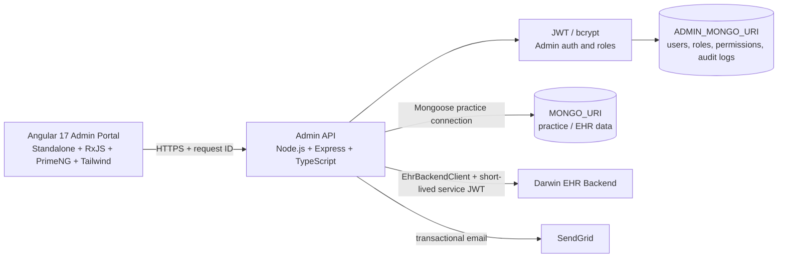

# EHR Admin Portal Architecture

## Scope

This document describes the Step 1 foundation for Edvak's internal EHR Admin Portal. The portal uses Angular 17 standalone components, an Express/TypeScript backend, two isolated MongoDB connections, and a controlled integration with the Darwin EHR backend.

## System diagram

## Backend layering

Requests flow through `routes -> controllers -> services -> models`, with cross-cutting concerns in `middleware`. Configuration and connection factories are isolated in `config`. `EhrBackendClient` is the only integration boundary for Darwin calls; it must mint short-lived service JWTs and never expose those credentials to the browser.

## Security foundations

- Secrets are supplied through environment variables; no secret is committed.
- CORS uses an explicit allowlist.
- Helmet adds secure HTTP headers.
- Rate limiting protects the API boundary.
- Every request receives or preserves an `X-Request-Id` value.
- Joi validation is available as reusable route middleware.
- `JWT_SECRET` and `REFRESH_SECRET` are deliberately separate variables.

## Known flaws to fix in later steps

1. Tokens in `sessionStorage` need a safer storage and refresh strategy.
2. URL-matching permissions are brittle and should become capability-based authorization.
3. Dashboard data is currently dummy data and needs real service-backed metrics.
4. Duplicate invoice systems need reconciliation into one authoritative workflow.
5. Audit logging needs to become a central, immutable audit-log service.
